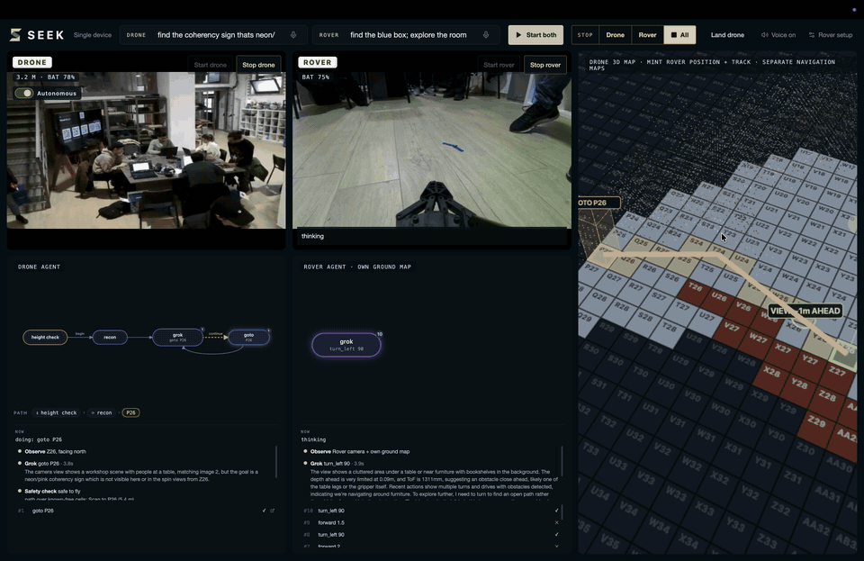
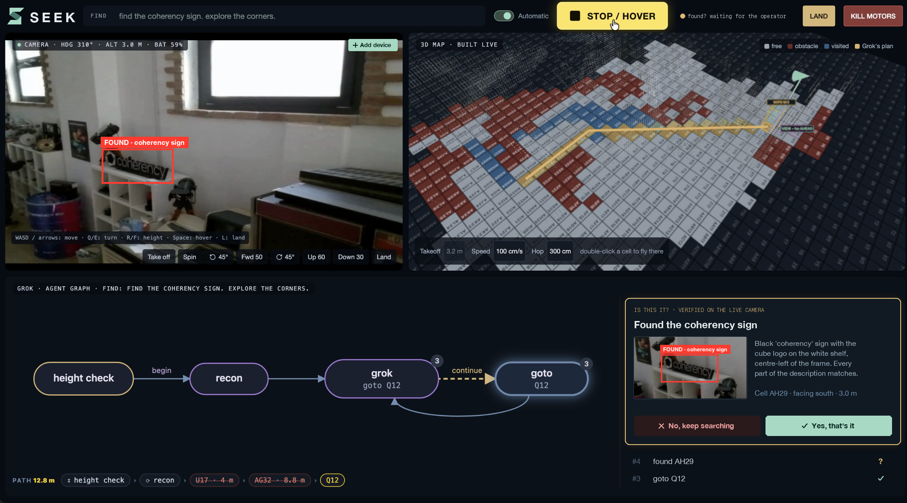

<p align="center">
  
</p>

<h1 align="center">SEEK</h1>
<p align="center"><b>Give it a mission. Let it act.</b><br>
Autonomous AI-powered devices: tell a drone and a ground rover what to find in plain language, and Grok plans every move.</p>

Built for the Grok Hackathon at the Museum (Ctrl+Alt Museum, Pavia, 4-5 November 2026).

---

## What it does

An operator types or speaks a mission, such as *"find the coherency sign, explore the corners"*. Each device then runs its own Grok agent loop:

1. **Observe:** the live camera frame, plus a 3D map the device builds as it moves.
2. **Think:** Grok picks one action (`goto <cell>`, `look <heading>`, `spin`, `found`) and explains why.
3. **Check:** a safety layer turns the action into a flight path over known-free cells, or refuses it.
4. **Act:** the drone or rover executes it, and the loop repeats.
5. **Verify:** on a possible find, Grok takes a second look at the live camera, draws a **red bounding box** around the object and asks the human to confirm.

<p align="center">
  
</p>

Every decision is shown live as an agent graph. You can see what Grok saw, what it decided, how long it took, and whether the safety check passed. The operator can approve each move or switch to **Autonomous**.

## Features

| | |
|---|---|
| **Single device** | One drone: live camera, a 3D map built live (depth per frame, then voxels, then a 50 cm grid), the agent graph, and manual controls (WASD, take off, spin, land). |
| **Multi device** | Drone and rover side by side (`/?multi`, or **+ Add device** on the single page). Each has its own goal, its own Grok agent and its own map, and each can be started and stopped independently. The drone's 3D map also shows the rover's live position and track. |
| **Rover agent** | A RoboMaster EP running its own look, think, act loop. It drives forward, turns and explores, brakes on its ToF distance sensor and a depth check, and reports finds with a red box. |
| **Find verification** | A find is only reported after a second Grok check on the live camera. The operator then confirms it or rejects it, and a rejection sends the agent back to searching. |
| **Grok Voice** | The mic in each goal box uses Grok speech-to-text (`/v1/stt`). The drone's decisions are read aloud with Grok text-to-speech (`/v1/tts`), with a **Voice on/off** toggle. The API key stays on the server. |
| **Safety** | STOP/HOVER, KILL MOTORS, LAND, and per-device **STOP Drone / Rover / All**. Optional per-move approval. A 0.8 s rover watchdog. Automatic camera reconnect. |
| **Tracing** | Every mission is saved with the prompt, images and reply for each decision. Traces go to Phoenix (http://localhost:6006, project `seek`). |

## Quick start

Requires [uv](https://docs.astral.sh/uv/getting-started/installation/), Node.js 22+ and an xAI API key.

```sh
git clone --recurse-submodules https://github.com/eddii1/grok_hackathon.git
cd grok_hackathon
(cd backend && uv sync && cp .env.example .env)   # then set XAI_API_KEY in backend/.env
(cd frontend && npm ci)
```

### One command per mode (real hardware)

```sh
run/single.sh                  # drone only        -> http://localhost:5173/
run/multi.sh                   # drone + rover     -> http://localhost:5173/?multi
DRONE_IP=auto run/single.sh    # find the drone on the network instead of a fixed IP
```

- **What the scripts start:** `run/single.sh` starts the drone server and the frontend. `run/multi.sh` also starts the rover bridge, connects the rover and starts the multi service.
- **Rover watchdog:** `run/multi.sh` watches the rover's odometry and does a full reconnect if the session goes silent.
- **Logs and overrides:** logs go to `run/logs/`. Ctrl+C stops everything. Override addresses with `DRONE_IP=...` and `ROVER_IP=...`.

**Put the drone on your phone hotspot** (station mode). Power it on so it shows its own `TELLO-xxxx` / `RMTT-xxxx` Wi-Fi, then run:

```sh
HOTSPOT_PASS=<password> run/drone_join.sh <hotspot-ssid> <drone-ssid>
```

The drone accepts commands only from the first program that contacts it after it boots. If startup reports `did not accept 'command'`, power-cycle the drone.

**Rover on Apple Silicon:** DJI's `robomaster` SDK ships an Intel-only video decoder. Run `bash rover/setup_mac.sh` once. It builds `rover/.venv`, and `rover/sdk_compat.py` replaces the decoder with PyAV.

### No hardware: the recorded flight

```sh
cd backend && uv run fleet-viewer --video ../drone_flight_video.avi
cd frontend && npm run dev                # second terminal -> http://localhost:5173/
```

This runs the real dashboard and the real Grok agent on recorded footage. The first launch downloads the depth model. `http://localhost:5173/?sim` is a separate browser-only mock that uses neither the recording nor Grok. Other camera sources are `--webcam 0` (you carry the laptop and follow the instructions) and `--sim room_360.jpg` (a simulated drone inside a 360° photo).

## Architecture

```
 browser (React, Vite :5173)
   ├── /api/*        ─► fleet-viewer      :8001  drone harness, live map, Grok agent, /tts, /stt
   └── /api/multi/*  ─► fleet-multiplayer :8002  rover agent + proxy to :8001 and :5001
                              └──────────► rover bridge (Flask) :5001 ─► RoboMaster EP (SDK, PyAV video)
 fleet-viewer ─► RoboMaster TT / Tello (raw UDP SDK)      Grok API: decisions, verification, voice
```

| Path | What |
|---|---|
| `backend/src/fleet/drone.py` | `Drone`: every command, safety checks and logging. The backends are `TelloBackend` (raw UDP), `SimBackend`, `VideoBackend` and `WebcamBackend`. |
| `backend/src/fleet/harness.py` | `Seek`, the drone agent loop. Grok answers with one action, `prepare()` turns it into a checked path, `act()` flies it, and `verify()` adds the bounding box. |
| `backend/src/fleet/mapper.py` | `LiveMap`: frames plus pose become the 3D voxels and the 50 cm grid that Grok reads. |
| `backend/src/fleet/viewer.py` | Drone server (FastAPI): `/state`, `/cmd/*`, `/agent/start`, `/approve`, `/confirm`, `/points`, `/tts`, `/stt`. |
| `backend/src/fleet/multiplayer.py` | Multi service: the rover's Grok agent and its own ground map, independent start and stop per device, and the merged 3D map. |
| `rover/` | RoboMaster EP bridge (Flask): pairing, chassis, arm, ToF, camera stream with EOF and stall detection. |
| `frontend/src/live/` | `LiveApp` (single), `MultiApp` (multi), `Map3D`, `DecisionGraph`, `VoiceButton`, `Narrator`, `Logo`. |
| `run/` | Startup scripts. |
| `docs/` | [`plan.md`](https://github.com/eddii1/grok_hackathon/blob/main/docs/plan.md) (architecture and interface contracts), [`tracks.md`](https://github.com/eddii1/grok_hackathon/blob/main/docs/tracks.md), [`hardware/robomaster-tt/`](https://github.com/eddii1/grok_hackathon/tree/main/docs/hardware/robomaster-tt) (drone SDK docs). |

Repos: [`grok_hackathon`](https://github.com/eddii1/grok_hackathon) (this one), [`backend`](https://github.com/eddii1/grok_hackathon_backend) and [`frontend`](https://github.com/eddii1/grok_hackathon_frontend), both submodules. Coding agents start from [`AGENTS.md`](https://github.com/eddii1/grok_hackathon/blob/main/AGENTS.md).

## How Grok is used

- **Decisions:** structured outputs, one action per step, given the camera frame, spin views and the map grid. Set `SEEK_MODEL` to a fast non-reasoning model.
- **Verification:** a focused yes/no question on the live frame, which returns the evidence and a bounding box.
- **Rover agent:** its own vision prompt with distance-sensor and depth context. It ignores the drone.
- **Grok Voice:** speech-to-text for the goal box and text-to-speech for narrating the steps.

## Results so far

- **Decision latency:** the default reasoning model took **47 s** per decision. A fast non-reasoning model (`SEEK_MODEL`) answers in **about 2 s**, and live runs show Grok step times of 3.8-5.4 s in the agent graph. That makes live flight possible.
- **Map payload:** the multi 3D map payload went from about 2.7 MB per update to roughly a tenth of that, by sending at most 12,000 points rounded to 2 decimals. This is an estimate from the payload format, not a benchmark.
- **Still to measure:** found-rate and time-to-find against a baseline (fixed lawnmower sweep, no Grok) on the jury's case.

## Known limitations

- The drone obeys only the first program that contacts it after boot, so power-cycle it between sessions.
- The rover's turn direction and speeds were set without on-robot measurement. Check them on the first run.
- Rover autonomy is deliberately simple: drive forward or turn, braking on its distance sensor. It has no path planning around obstacles yet.
- Both depth models share one laptop. Multi mode throttles the rover's depth to leave headroom for the drone's mapping.
- The mic and the voice narration go through the drone server, so they are offline when the drone server is down.
- A find always needs a human confirmation. This is intentional.

## Roadmap

1. Measured found-rate and time-to-find against a sweep baseline on a fixed test set.
2. Shared mission planning: Grok splits one goal across devices and assigns areas.
3. Rover path planning on its own ground map, plus arm and gripper actions, for example picking up a found object.
4. More device types behind the same `Drone`-style interface (any SDK that can `send`, `frame` and `telemetry`).
5. Cloud fleet console: many sites, mission history and evidence review.
